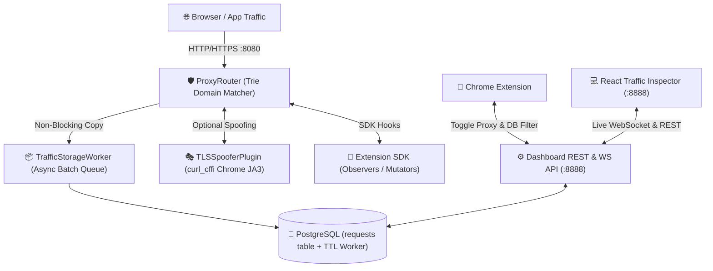

<h1 align="center">
    <br>
    
    <br>
    Proxify
    <br>
    <small>High-Performance HTTP/HTTPS/WebSocket Request Tracker & Traffic Inspection Framework</small>
</h1>

<p align="center">
    <strong>English</strong> | <a href="README_vi.md">Tiếng Việt</a>
</p>

<p align="center">
    <a href="https://python.org" alt="Python version">
        </a>
    <a href="https://mitmproxy.org/" alt="Mitmproxy">
        </a>
    <a href="https://react.dev/" alt="React">
        </a>
    <a href="https://postgresql.org" alt="PostgreSQL">
        </a>
    <a href="#" alt="License">
        </a>
</p>

<p align="center">
    <a href="#overview"><strong>Overview</strong></a>
    &middot;
    <a href="#core-features"><strong>Core Features</strong></a>
    &middot;
    <a href="#extension-sdk"><strong>Extension SDK</strong></a>
    &middot;
    <a href="#quick-start"><strong>Quick Start</strong></a>
    &middot;
    <a href="#architecture"><strong>Architecture</strong></a>
    &middot;
    <a href="#structure"><strong>Directory Structure</strong></a>
</p>

---

## 🌟 Overview

**Proxify** is a lightweight, high-performance **HTTP, HTTPS, HTTP/2, and WebSocket request tracking and traffic inspection framework**.

Built on top of **Mitmproxy 10**, **AsyncIO**, and **PostgreSQL**, Proxify is designed as a clean, developer-first observability proxy that unites:
1. **Asynchronous Request Tracking Core**: Non-blocking HTTPS/TLS interception, GraphQL operation parsing, and batched raw traffic ingestion into PostgreSQL.
2. **TLS/JA3 Fingerprint Spoofing**: Native `curl_cffi` integration that disguises upstream client connections as genuine Chrome/Safari TLS handshakes (`chrome131`) so modern WAF-protected web apps (Cloudflare, Akamai) load seamlessly during traffic inspection.
3. **1-Click Chrome Extension Controller**: A minimal Manifest V3 browser extension for toggling proxy routing (`127.0.0.1:8080`) and configuring live database capture filters per domain.
4. **Interactive Real-Time Dashboard**: A modern React + TypeScript web interface featuring a Live Traffic Inspector (headers, payloads, status codes, latency, and GraphQL operation names), domain filtering, and retention policies.

---

## 🛡️ Core Features

### 1. High-Throughput Traffic Interception & Tracking
- **Full HTTPS/TLS Inspection**: Generates and manages local CA root certificates to inspect encrypted traffic across desktop browsers, CLI tools, and mobile emulators.
- **HTTP/2 & WebSocket Support**: Captures multiplexed HTTP/2 streams and full-duplex WebSocket frames without degrading connection stability.
- **Asynchronous Batch Storage (`TrafficStorageWorker`)**: Buffers and writes captured requests/responses to PostgreSQL in background batches (`COMMIT_BATCH_SIZE` / `COMMIT_INTERVAL`), ensuring zero latency overhead on live browsing.
- **GraphQL Operation Detection**: Automatically parses GraphQL request bodies (`utils/graphql.py`) to extract `operationName` and index queries/mutations for instant filtering.
- **Smart Static & Media Streaming**: Automatically streams large media segments, `.css` stylesheets, and unmodified `.js` bundles directly to the client with zero RAM buffering.

### 2. TLS Fingerprint Spoofing & WAF Compatibility
- **Browser TLS Impersonation (`plugins/tls_spoofer.py`)**: Standard Python/Mitmproxy TLS handshakes are frequently blocked by Cloudflare or Akamai JA3/JA4 fingerprinting. Proxify's `TLSSpooferPlugin` replays requests through `curl_cffi` (`impersonate="chrome131"`) for configured `SPOOF_DOMAINS` so pages load normally while being tracked.
- **Soft-Block & Retry Engine (`utils/stealth.py`)**: Detects Cloudflare challenge headers, rate limits (`429`/`503`), and transient upstream errors with automatic exponential backoff.

### 3. 1-Click Chrome Extension (`backend/chrome_extension/`)
- **Instant Proxy Toggle**: Route or bypass Chrome traffic through Proxify (`127.0.0.1:8080`) with a single click and live status badge (`ON`/`OFF`).
- **Database Capture Control**: Enable or pause PostgreSQL traffic recording on the fly and specify comma-separated domain allowlists (`db_allowed_domains`) directly from the popup.
- **Strict Least-Privilege Manifest**: Requires only `proxy` and `storage` permissions—no intrusive content scripts or cookie readers.

---

## 🔌 Pluggable Extension SDK (`proxify.sdk`)

Proxify follows **Clean Architecture** and the **Open/Closed Principle**. The Core engine remains 100% platform-agnostic while exposing a rich `ExtensionContext` for custom plugins and private extensions:

- **Prefix-Trie Domain Router (`ProxyRouter`)**: $O(k)$ domain matching for registering request/response `Observer`s (non-blocking) and `Mutator`s (in-flight modification).
- **Custom Record Filters**: Register custom predicates via `context.register_record_filter(fn)` to exclude noisy telemetry or streaming endpoints from database logging.
- **CQRS Event Bus & Worker**: Publish domain events from proxy interceptors and handle them asynchronously via `context.register_topic_handler(topic, handler)`.
- **Dynamic UI & API Registration**: Extensions can mount custom `aiohttp` routes (`context.register_routes`) and inject navigation tabs into the React Dashboard (`context.register_ui_page`).

---

## 🚀 Quick Start

### Method 1: Docker Compose (Recommended)

Start the entire stack (Backend Proxy + PostgreSQL + React UI) with a single command:

```bash
# 1. Clone the repository
git clone https://github.com/tmph2003/Proxify.git
cd Proxify

# 2. Launch all services
docker compose up -d
```

Access your environment:
- **Web Dashboard (React UI):** `http://localhost:8888`
- **Proxy Server (Mitmproxy):** `http://localhost:8080`
- **PostgreSQL Database:** Port `5432`

> 💡 **One-Time SSL Certificate Setup:**  
> Route your browser/device traffic through `127.0.0.1:8080`, then visit `http://mitm.it` in your browser to install the Mitmproxy Root CA certificate.

---

### Method 2: Manual Development Mode

```bash
# 1. Install Python requirements
pip install -r backend/requirements.txt
pip install -e ./backend

# 2. Configure environment
cp .env.example .env

# 3. Start Proxy Backend
python -m proxify

# 4. Start React Frontend (in a separate terminal)
cd frontend
npm install
npm run dev
```

---

## 📂 Architecture Overview



---

## 📂 Directory Structure

```text
Proxify/
├── backend/
│   ├── chrome_extension/        # 1-Click Proxy Toggle & DB Capture Filter Extension (Manifest V3)
│   ├── proxify/                 # Core Request Tracking Framework
│   │   ├── core/                # ProxyRouter, EventBus, TrafficStorageWorker, DatabaseManager
│   │   ├── database/            # PostgreSQL connection pool, schema, and TTL retention worker
│   │   ├── plugins/             # BasePlugin, PluginRegistry, and TLSSpooferPlugin
│   │   ├── sdk/                 # Public Extension SDK (BaseExtension, ExtensionContext, Loader)
│   │   ├── utils/               # Core utilities (TLS stealth engine, GraphQL parser, content helpers)
│   │   ├── server.py            # Mitmproxy DumpMaster & V1GlobalObserver
│   │   └── dashboard.py         # REST API & real-time WebSocket broadcaster
│   └── tests/                   # Core unit & integration test suite (52 tests)
├── frontend/                    # React + TypeScript + Vite Traffic Inspector UI
│   ├── src/                     # Live traffic table, request/response detail modal, filter bar
│   └── nginx.conf               # Nginx production reverse-proxy configuration
├── scripts/                     # Operational utility scripts (Chrome proxy policy & stability checks)
├── docs/                        # Architecture & module documentation
└── docker-compose.yml           # Multi-container orchestration (proxify, ui, db)
```

---

## 📜 License

This project is licensed under the **MIT License**. Contributions, issues, and feature requests are welcome!
