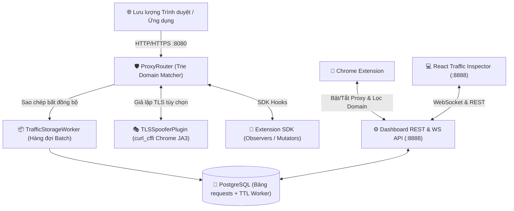

<h1 align="center">
    <br>
    
    <br>
    Proxify
    <br>
    <small>High-Performance HTTP/HTTPS/WebSocket Request Tracker & Traffic Inspection Framework</small>
</h1>

<p align="center">
    <a href="README.md">English</a> | <strong>Tiếng Việt</strong>
</p>

<p align="center">
    <a href="https://python.org" alt="Python version">
        </a>
    <a href="https://mitmproxy.org/" alt="Mitmproxy">
        </a>
    <a href="https://react.dev/" alt="React">
        </a>
    <a href="https://postgresql.org" alt="PostgreSQL">
        </a>
    <a href="#" alt="License">
        </a>
</p>

<p align="center">
    <a href="#overview"><strong>Tổng quan</strong></a>
    &middot;
    <a href="#core-features"><strong>Tính năng cốt lõi</strong></a>
    &middot;
    <a href="#extension-sdk"><strong>Extension SDK</strong></a>
    &middot;
    <a href="#quick-start"><strong>Bắt đầu nhanh</strong></a>
    &middot;
    <a href="#architecture"><strong>Kiến trúc hệ thống</strong></a>
    &middot;
    <a href="#structure"><strong>Cấu trúc thư mục</strong></a>
</p>

---

## 🌟 Tổng Quan (Overview)

**Proxify** là một nền tảng framework gọn nhẹ, hiệu năng cao chuyên dùng để **theo dõi (request tracking), đánh chặn và phân tích lưu lượng mạng (traffic inspection)** trên các giao thức HTTP, HTTPS, HTTP/2 và WebSocket.

Được xây dựng trên nền tảng **Mitmproxy 10**, **AsyncIO** và **PostgreSQL**, Proxify tập trung vào sự tinh gọn, chuẩn mực theo Clean Architecture:
1. **Lõi Tracking Bất Đồng Bộ (Async Request Tracker Core)**: Giải mã HTTPS/TLS không chặn luồng, tự động bóc tách truy vấn GraphQL và ghi nhận dữ liệu thô theo lô (batch) vào PostgreSQL.
2. **Giả Lập Vân Tay TLS/JA3 (TLS Fingerprint Spoofing)**: Tích hợp `curl_cffi` để giả lập chữ ký TLS ClientHello của trình duyệt thật (`chrome131`), giúp các trang web có hệ thống bảo vệ chống bot khắt khe (Cloudflare, Akamai) vẫn tải mượt mà khi đi qua proxy để phục vụ việc theo dõi request.
3. **Tiện Ích Điều Khiển 1-Click Trên Chrome**: Chrome Extension chuẩn Manifest V3 tối giản, chỉ dùng để bật/tắt định tuyến traffic về Proxify (`127.0.0.1:8080`) và cấu hình bộ lọc domain lưu vào Database.
4. **Giao Diện Giám Sát Thời Gian Thực (Live Traffic Dashboard)**: Ứng dụng Web React + TypeScript hiện đại cho phép quan sát trực tiếp từng Request/Response (Headers, Payload, Status, Latency, GraphQL Operation), lọc theo domain và tự động dọn dẹp dữ liệu cũ theo chu kỳ (TTL Retention).

---

## 🛡️ Tính Năng Cốt Lõi (Core Features)

### 1. Theo Dõi & Lưu Trữ Request Hiệu Năng Cao
- **Giải mã HTTPS/TLS toàn diện**: Tự động khởi tạo và quản lý chứng chỉ Root CA để phân tích lưu lượng mã hóa từ trình duyệt máy tính, công cụ CLI hoặc thiết bị di động.
- **Hỗ trợ HTTP/2 & WebSocket**: Bắt trọn vẹn các luồng ghép kênh HTTP/2 và gói tin hai chiều WebSocket mà không làm đứt kết nối.
- **Ghi nhận Database theo lô bất đồng bộ (`TrafficStorageWorker`)**: Đẩy toàn bộ Request/Response vào hàng đợi bộ nhớ và commit theo batch (`COMMIT_BATCH_SIZE` / `COMMIT_INTERVAL`) xuống PostgreSQL, đảm bảo độ trễ bằng 0 đối với trải nghiệm duyệt web.
- **Nhận diện tự động GraphQL (`utils/graphql.py`)**: Tự động phân tích payload GraphQL để trích xuất `operationName`, hỗ trợ lọc nhanh các truy vấn API phức tạp trên Dashboard.
- **Truyền tải thông minh (Smart Asset & Media Streaming)**: Tự động stream trực tiếp các luồng video/audio, file `.css` và các gói `.js` không cần can thiệp qua thẳng trình duyệt mà không đệm vào RAM.

### 2. Giả Lập TLS/JA3 & Tương Thích WAF
- **Giả lập TLS Trình duyệt (`plugins/tls_spoofer.py`)**: Các kết nối TLS mặc định của Python/Mitmproxy thường bị chặn bởi hệ thống kiểm tra JA3/JA4 của Cloudflare hoặc Akamai. `TLSSpooferPlugin` sử dụng `curl_cffi` (`impersonate="chrome131"`) cho các tên miền nằm trong `SPOOF_DOMAINS`, giúp trang đích hoạt động bình thường trong suốt quá trình bắt gói tin.
- **Phát hiện Soft-Block & Tự động thử lại (`utils/stealth.py`)**: Nhận diện các trang thử thách Cloudflare, lỗi giới hạn tốc độ (`429`/`503`) và tự động thực hiện Exponential Backoff.

### 3. Tiện Ích Mở Rộng Chrome (`backend/chrome_extension/`)
- **Bật/Tắt Proxy 1-Click**: Định tuyến hoặc ngắt định tuyến toàn bộ lưu lượng Chrome qua Proxify (`127.0.0.1:8080`) chỉ với một cú nhấp chuột cùng biểu tượng trạng thái trực quan (`ON`/`OFF`).
- **Điều khiển Lưu trữ Database**: Bật/tắt ghi nhận request vào PostgreSQL tức thì và cấu hình danh sách domain cho phép (`db_allowed_domains`) ngay trên Popup.
- **Quyền hạn tối thiểu (Least Privilege)**: Chỉ yêu cầu quyền `proxy` và `storage` — hoàn toàn không đọc cookie hay chèn script vào trang web của người dùng.

---

## 🔌 Kiến Trúc Mở Rộng Qua SDK (`proxify.sdk`)

Proxify tuân thủ nghiêm ngặt **Clean Architecture** và nguyên lý **Open/Closed (SOLID)**. Lõi hệ thống hoàn toàn độc lập với các nền tảng bên ngoài nhưng cung cấp sẵn `ExtensionContext` mạnh mẽ để người dùng tự viết thêm các extension riêng (đặt tại `private/extensions/` hoặc cấu hình qua `PROXIFY_EXTENSIONS_DIR`):

- **Định tuyến Domain theo cây tiền tố (`ProxyRouter`)**: Tra cứu tên miền với độ phức tạp $O(k)$ cho cả `Observer` (quan sát bất đồng bộ) và `Mutator` (can thiệp gói tin trực tiếp).
- **Bộ lọc Bản ghi Tùy chỉnh (`register_record_filter`)**: Cho phép extension đăng ký hàm kiểm tra để bỏ qua không lưu các request rác/telemetry vào Database.
- **CQRS Event Bus & Background Worker**: Phát sự kiện từ luồng proxy và đăng ký hàm xử lý bất đồng bộ qua `context.register_topic_handler(topic, handler)`.
- **Mở rộng API & Giao diện Động**: Tự động gắn thêm route `aiohttp` (`context.register_routes`) và thêm trang điều hướng trên thanh menu React Dashboard (`context.register_ui_page`).

---

## 🚀 Bắt Đầu Nhanh (Quick Start)

### Cách 1: Chạy Bằng Docker Compose (Khuyên Dùng)

Khởi chạy trọn bộ 3 dịch vụ (Proxy Backend + PostgreSQL + React UI) chỉ với một câu lệnh:

```bash
# 1. Clone mã nguồn
git clone https://github.com/tmph2003/Proxify.git
cd Proxify

# 2. Khởi chạy toàn bộ hệ thống
docker compose up -d
```

Các dịch vụ sẽ sẵn sàng tại:
- **Web Dashboard (React UI):** `http://localhost:8888`
- **Proxy Server (Mitmproxy):** `http://localhost:8080`
- **PostgreSQL Database:** Cổng `5432`

> 💡 **Cài đặt chứng chỉ SSL/TLS (Chỉ làm 1 lần duy nhất):**  
> Bật Proxy về `127.0.0.1:8080`, sau đó truy cập `http://mitm.it` trên trình duyệt để tải và cài đặt chứng chỉ Mitmproxy Root CA vào máy.

---

### Cách 2: Chạy Thủ Công (Development Mode)

```bash
# 1. Cài đặt thư viện Python
pip install -r backend/requirements.txt
pip install -e ./backend

# 2. Cấu hình biến môi trường
cp .env.example .env

# 3. Khởi chạy Backend Proxy
python -m proxify

# 4. Khởi chạy Frontend UI (tại terminal khác)
cd frontend
npm install
npm run dev
```

---

## 📂 Kiến Trúc Hệ Thống (Architecture)



---

## 📂 Cấu Trúc Thư Mục (Directory Structure)

```text
Proxify/
├── backend/
│   ├── chrome_extension/        # Tiện ích Chrome bật/tắt Proxy & cấu hình lọc DB (Manifest V3)
│   ├── proxify/                 # Lõi Framework Theo Dõi Request
│   │   ├── core/                # ProxyRouter, EventBus, TrafficStorageWorker, DatabaseManager
│   │   ├── database/            # Quản lý Connection Pool PostgreSQL, Schema & TTL Worker
│   │   ├── plugins/             # BasePlugin, PluginRegistry và TLSSpooferPlugin
│   │   ├── sdk/                 # Public Extension SDK (BaseExtension, ExtensionContext, Loader)
│   │   ├── utils/               # Công cụ lõi (TLS Stealth Engine, GraphQL Parser, Content Helpers)
│   │   ├── server.py            # Mitmproxy DumpMaster & V1GlobalObserver
│   │   └── dashboard.py         # REST API & WebSocket truyền tải lưu lượng thời gian thực
│   └── tests/                   # Bộ kiểm thử tự động pytest cho Core (52 tests)
├── frontend/                    # Giao diện Web giám sát lưu lượng (React + TypeScript + Vite)
│   ├── src/                     # Bảng Live Traffic, Modal chi tiết Request/Response, Thanh bộ lọc
│   └── nginx.conf               # Cấu hình Nginx reverse-proxy cho Docker
├── scripts/                     # Script tiện ích vận hành & kiểm tra độ ổn định hệ thống
├── docs/                        # Tài liệu kiến trúc & lịch sử thay đổi kỹ thuật
└── docker-compose.yml           # Khởi chạy đa dịch vụ (proxify, ui, db)
```

---

## 📜 Giấy Phép (License)

Dự án được phân phối dưới giấy phép **MIT License**. Mọi đóng góp, báo lỗi (Issue) và Pull Request đều được chào đón!
